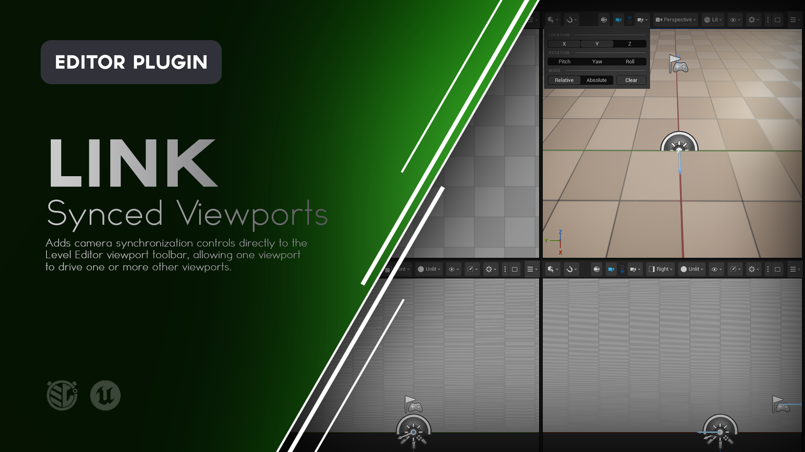

# Link

**Viewport Camera Synchronization for Unreal Engine**

**Spend less time repositioning viewports. Spend more time building your level.**

Link keeps multiple **Level Editor viewport cameras** moving together without forcing them into the same view. Choose a Perspective Source, assign one or more Targets, and navigate through your level while each Target keeps the position or orientation you need for the task at hand.

    

  

---

## Your viewports should work together

Multiple viewports are valuable when building environments, blocking out spaces, or comparing the same area from different angles. But each camera normally moves on its own. Every time you navigate somewhere new, you have to reposition the other views to keep them useful.

**Link removes that repetition.**

- **Navigate once, see more.** Move a single Perspective Source and have multiple Target viewports follow the working area.
- **Keep each view useful.** Use Relative linking to preserve different camera offsets and viewing directions instead of making every viewport identical.
- **Match only what matters.** Choose specific position and rotation axes, or use Absolute linking to keep selected coordinates aligned.
- **Align on demand.** Press Sync for an immediate one-shot match without changing your continuous linking mode.
- **Stay in Unreal's workflow.** Control Link directly from each native Level Editor viewport toolbar, without creating Actors or changing your level.

## Explore the documentation

> ### [**Link Documentation — Full User Guide and Technical Reference**](https://mippi-the-dork.github.io/Link/)
>
> **Everything you need to learn and use Link, in one place.** Set up your first linked viewports, compare Relative and Absolute, configure position and rotation axes, follow real editor workflows, or look up implementation details and troubleshooting.
>
> **[Get Started](https://mippi-the-dork.github.io/Link/?page=01-getting-started%2FREADME.md)** · **[All Linking Controls](https://mippi-the-dork.github.io/Link/?page=02-linking-controls%2FREADME.md)** · **[Workflows](https://mippi-the-dork.github.io/Link/?page=03-workflows-and-behavior%2FREADME.md)** · **[Troubleshooting](https://mippi-the-dork.github.io/Link/?page=05-support-and-troubleshooting%2FREADME.md)**

The README is an overview of what Link offers. **The [documentation website](https://mippi-the-dork.github.io/Link/) is the maintained reference for exact control behavior, installation, workflows and technical details.**

## One Source. Multiple Targets. Your choice of synchronization.

Link provides three complementary ways to coordinate Level Editor viewport cameras.

| Linking controls | What you can do |
| --- | --- |
| **[Source and Targets](https://mippi-the-dork.github.io/Link/?page=02-linking-controls%2Froles%2FDESIGN.md)** | Assign one Perspective Source and several Perspective or Orthographic Targets, each with its own useful view. |
| **[Relative](https://mippi-the-dork.github.io/Link/?page=02-linking-controls%2Frelative%2FDESIGN.md)** | Apply Source movement deltas to Targets while maintaining their independent offsets. This is the default mode. |
| **[Absolute](https://mippi-the-dork.github.io/Link/?page=02-linking-controls%2Fabsolute%2FDESIGN.md)** | Match the Source's selected position or rotation coordinates whenever the corresponding Source transform changes. |
| **[Sync](https://mippi-the-dork.github.io/Link/?page=02-linking-controls%2Fsync%2FDESIGN.md)** | Immediately copy the enabled Source coordinates to valid Targets—whether continuous Link is on or off. |
| **[Position and Rotation Axes](https://mippi-the-dork.github.io/Link/?page=02-linking-controls%2Faxes%2FDESIGN.md)** | Enable X, Y, Z, Pitch, Yaw and Roll individually, so only the parts you want are synchronized. |
| **[Orthographic Viewports](https://mippi-the-dork.github.io/Link/?page=02-linking-controls%2Forthographic%2FDESIGN.md)** | Move Top, Front and Side Targets along with your Perspective Source without rotating their fixed projections. |
| **[Toolbar and Settings](https://mippi-the-dork.github.io/Link/?page=02-linking-controls%2Ftoolbar%2FDESIGN.md)** | Access Sync, continuous Link, viewport roles and configuration beside Unreal's viewport camera controls. |

All Targets share the same mode and axis settings, but each retains its own independent camera state on the axes Link does not control. Link coordinates **editor cameras**, not level Actors or runtime camera systems.

## Useful in real production workflows

### Keep your reference views nearby

Navigate a level through a Perspective viewport while Top and Front Targets follow your working area. Their fixed orientations and independent zoom remain available for checking alignment and layout.

[**See the multi-viewport workflow →**](https://mippi-the-dork.github.io/Link/?page=03-workflows-and-behavior%2Fworkflows%2FDESIGN.md)

### Work from several perspectives at once

Place a second Perspective viewport at a useful side angle, then enable Relative mode. As you move the Source, the Target follows its movement while keeping its own offset and viewing direction. You can inspect the same space without repeatedly navigating two cameras.

[**Learn how Relative linking works →**](https://mippi-the-dork.github.io/Link/?page=02-linking-controls%2Frelative%2FDESIGN.md)

### Match horizontal position, keep independent height

Choose Absolute mode, enable X and Y, and disable Z. When the Source moves, the Target matches the horizontal coordinates without replacing its height. You can keep an overhead perspective aligned with a lower working view.

### Align first, then establish your view

Press **Sync** to match selected coordinates immediately. Reposition each Target into the view you want, switch to Relative if needed, and continue navigating. Sync works independently of whether continuous Link is enabled.

### Pause without losing your setup

Temporarily disable Link while repositioning viewports. When you re-enable it, Targets follow **future** Source movement rather than suddenly catching up on the travel you made while Link was off. Link also respects native camera locks and suspends during Play In Editor.

[**Read about camera locks and PIE →**](https://mippi-the-dork.github.io/Link/?page=03-workflows-and-behavior%2Fsafety%2FDESIGN.md)

## Get Link

**Link v1.0.0** targets **Unreal Engine 5.8.x on Windows 64-bit** and runs in the **Editor only**. For prebuilt installations, choose the package labeled for your engine version; the documented v1.0.0 package targets **UE 5.8.3**.

Install from a compatible GitHub Release, through Fab if available for your engine version, or build the source in your project's `Plugins/Link` folder.

**[Download GitHub Releases](https://github.com/mippi-the-dork/Link/releases)** · **[Installation Guide](https://mippi-the-dork.github.io/Link/?page=01-getting-started%2Finstallation%2FDESIGN.md)** · **[First Viewport Setup](https://mippi-the-dork.github.io/Link/?page=01-getting-started%2Ffirst-session%2FDESIGN.md)**

## Important limitations

Link is an **editor viewport navigation utility**, not a runtime camera rig or a replacement for Unreal's viewport layout system.

- **Perspective Source required.** Orthographic views can be Targets, but a Perspective Level Editor viewport must drive synchronization.
- **Orthographic position only.** Top, Front and Side Targets do not receive Pitch/Yaw/Roll changes or synchronized orthographic zoom.
- **Camera locks are respected.** Link skips Targets locked to Actors or cinematic cameras and suspends when the Source is locked.
- **Play In Editor pauses synchronization.** Link doesn't control PIE or gameplay cameras.
- **Session-only configuration.** Source, Targets, axis settings and mode are not saved across Editor restarts; Clear restores the defaults without moving cameras.
- **No automatic snap from settings changes.** Switching Relative/Absolute or enabling an axis doesn't immediately align Targets. Press Sync when you want an instant copy.
- **No runtime content or Actor changes.** Link does not create Camera Actors, modify level geometry, change gameplay cameras, or add packaged-game dependencies.
- **Level Editor viewports only.** Specialized Asset Editor viewports are outside its current scope.

For full explanations, see [Limitations and FAQ](https://mippi-the-dork.github.io/Link/?page=05-support-and-troubleshooting%2Ffaq%2FDESIGN.md) and [Troubleshooting](https://mippi-the-dork.github.io/Link/?page=05-support-and-troubleshooting%2Ftroubleshooting%2FDESIGN.md).

## What's next?

**Link v1.0.0** establishes the core workflow: a single Perspective Source, multiple Targets, Relative and Absolute linking, one-shot Sync and independent axis controls.

No future Link version or feature set has been committed. Feature suggestions are welcome, but proposed additions should solve a clear multi-viewport editing problem without making the plugin more complicated than it needs to be.

[**View the Link Roadmap →**](https://mippi-the-dork.github.io/Link/?page=ROADMAP.md)

## Issues, feature requests and contributions

Found a bug? Please [open an issue](https://github.com/mippi-the-dork/Link/issues) with your Link/Unreal versions, installation method, Source and Target viewports, selected axes and mode, steps to reproduce, and a short recording or Output Log excerpt where helpful.

Have an idea? [Submit a feature request](https://github.com/mippi-the-dork/Link/issues) describing the workflow problem you'd like to solve and the result you're after.

**Pull requests are welcome.** For significant changes, open an issue first so the intended scope and direction can be discussed. Link aims to stay small, predictable and native to Unreal's existing viewport workflows.

## License

Link is distributed under the **MIT License**. See [LICENSE](LICENSE) for the full terms.

---

**Link is created by Mippi the Dork.**

**[Explore the Documentation](https://mippi-the-dork.github.io/Link/)** · **[Get Link](https://github.com/mippi-the-dork/Link/releases)** · **[Report an Issue](https://github.com/mippi-the-dork/Link/issues)**
