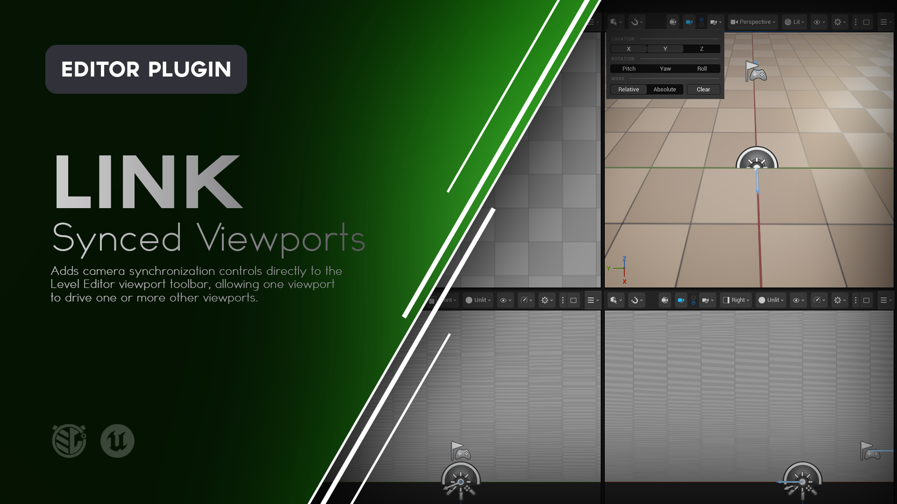

# Link Documentation

**Link v1.0.0 · Unreal Engine 5.8.x · Win64 · Editor-only**

Link keeps multiple **Level Editor viewport cameras** coordinated while letting each viewport remain useful on its own. Choose one Perspective Source, assign one or more Targets, and select which position and rotation axes participate. **Relative** preserves Target offsets; **Absolute** matches selected Source coordinates; **Sync** applies an immediate one-shot alignment.

*Link places camera synchronization controls directly in Unreal Engine's Level Editor viewport toolbar.*

## What can I accomplish?

- Navigate a large level in one Perspective viewport while a Top or Side reference view follows your location.
- Keep a separate perspective angle offset from your main camera, without constantly moving the second viewport by hand.
- Match only X/Y while preserving independent camera height, or synchronize turning while maintaining independent position offsets.
- Use **Sync** to align selected axes immediately, independently of the current continuous Link mode.

## First five minutes

1. [Install Link](01-getting-started/installation/DESIGN.md) and enable it under **Edit → Plugins**.
2. [Set up two or more Level Editor viewports](01-getting-started/first-session/DESIGN.md).
3. Choose one **Perspective Source** and at least one **Target** using their viewport toolbar selectors.
4. Leave the default **Relative** mode and **X/Y/Z enabled**, then turn on **Link** and move the Source.
5. Open [Link Settings](02-linking-controls/axes/DESIGN.md) to try different axis combinations, or press **Sync** for immediate alignment.

## What Link does not change

Link does **not** move level Actors, generate Camera Actors, control gameplay cameras, modify your saved level, or synchronize orthographic zoom. It operates on Level Editor viewport cameras and pauses while Play In Editor is active. Link's source, targets, mode and axis selections are **session-only**.

## Which documentation should I read?

**Design** explains what a user sees, where to click, why to choose an action, examples and troubleshooting. **Technical** explains native C++ editor integration, target eligibility, sampling, guards and state ownership. Every feature has one of each.

## Explore the manual

| Category | Topics | What you'll find |
| --- | ---: | --- |
| [01. Getting Started](01-getting-started/README.md) | 3 | Learn what Link does, install it, and synchronize your first viewports. |
| [02. Linking Controls](02-linking-controls/README.md) | 7 | Every viewport toolbar action and how it changes camera synchronization. |
| [03. Workflows and Editor Behavior](03-workflows-and-behavior/README.md) | 3 | Practical layouts and special editor conditions that affect synchronization. |
| [04. Technical Implementation](04-technical-implementation/README.md) | 2 | Source-grounded editor integration and camera update semantics. |
| [05. Support and Troubleshooting](05-support-and-troubleshooting/README.md) | 3 | Resolve common problems, update Link and provide actionable bug reports. |

## What's next?

The [Roadmap](ROADMAP.md) summarizes shipped v1.0 behavior separately from future considerations. The [Media Inventory](MEDIA_INVENTORY.md) lists planned screenshots/GIFs with precise recording instructions.

## Project and support

- [Source repository](https://github.com/mippi-the-dork/Link)
- [Releases](https://github.com/mippi-the-dork/Link/releases)
- [Report an issue](https://github.com/mippi-the-dork/Link/issues)

**Verification:** Documentation is based on the Link v1.0.0 README and inspected C++ source. End-to-end Unreal Editor and browser validation have not been claimed.
